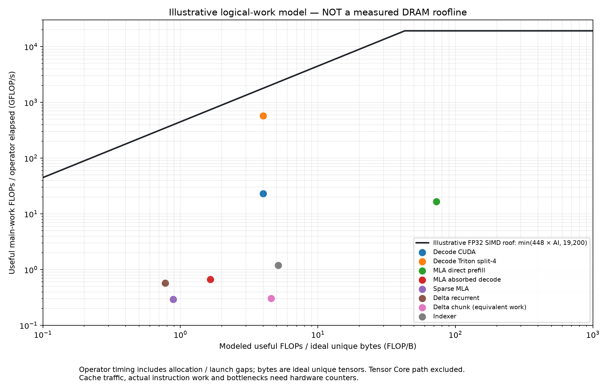

# Attention：延迟、吞吐、算术强度与 Roofline 分析

本报告根据仓库在 2026-10-29 RTX 5060 上已有的两轮 CUDA Events 实测，计算每个已实现 Attention 路径和配套算子的指标；不修改或调优内核。原始实现对应 `0096124`，后续提交只增加文档。数据、脚本与原始结果见文末。**实际 DRAM 访问字节和实际执行 FLOP 尚未测得；下文的算术强度和 Roofline 是透明假设下的逻辑模型，不是实测 Roofline，也不能单独用于判定瓶颈。**

## 1. 指标定义和测量边界

- **延迟**：两次独立进程各自 5 组 CUDA Event 时长的中位数，再取两者中位数；Dense 每组 10 次调用，阶段三至五每组 5 次调用。包含实际算子调用的 kernel、输出分配、部分临时分配与可能的主机提交空隙，不是单个 kernel 或真实服务端到端时延。GPU 未隔离、时钟未锁定；两次顺序固定，短操作波动明显。
- **工作项吞吐**：`每调用工作项数 / 延迟`。Attention 的工作项是 **batch 内 Query Token**（Decode 为 B，Prefill 为 B×T），Delta 为处理的 B×T，Indexer/Top-K 为 Query 行；Cache 写入为写入 Token 数。它不是模型在线生成 token/s，也没有计排队或整个网络。
- **主要有效 FLOP / 调用**：只统计下文规定的主要乘加，1 次乘加记为 2 FLOP；通常不包括 Softmax、exp、除法、归一化、mask、地址计算、merge、框架处理和无效 tile。Chunkwise 的计数是**等价递归有用工作**，并非此串行下三角 kernel 的实际执行 FLOP。`有效 GFLOP/s = 主要有效 FLOP / Event 延迟`，不是硬件指令吞吐。
- **理想逻辑字节**：每个有效逻辑输入、输出及所述 metadata 各读/写一次，假设同一 KV head/latent 在各 Query head 间可完全复用；不含实际 cache miss、内存事务、重复读取、部分 workspace/中间结果。它既不是计数器字节，也不是所有场景的严格物理下界：数据可能已在 L2，实际访问也可能更多。
- **模型算术强度**：`主要有效 FLOP / 理想逻辑字节`，单位 FLOP/B。`模型带宽项 = 448 × 模型算术强度`，单位 GFLOP/s；即使模型字节是合理估算，也不能把它当实测带宽或直接分类瓶颈。无合理统一 FLOP 计数的拷贝、指数类 gate 和整数 Top-K 用 `—`，不把它们当作零成本计算。

全部 **61 组**形状及公式逐行保存在 [metrics.csv](../results/attention_roofline_20261029/metrics.csv) 和 [metrics.json](../results/attention_roofline_20261029/metrics.json)。表中工作项/s是按上述定义的总速率；其变化反映固定形状下的算子执行效率，不等价于硬件 FLOP/s。

## 2. Roofline 使用的假设

[RTX 5060 官方规格](https://www.nvidia.com/en-us/geforce/news/ultimate-guide-to-5060/)给出 3840 CUDA cores 和 2.50 GHz boost；[NVIDIA GPU 规格表](https://www.nvidia.com/en-au/geforce/10-series/10-series-specs/)给出 448 GB/s 标称显存带宽。假设每个 CUDA core 每周期执行一个 FP32 FMA、一次 FMA 算 2 FLOP，得到示意 FP32 CUDA-core 算术峰值 `3840×2×2.50 GHz = 19.2 TFLOP/s`，**不是本机实测可持续峰值**。则示意线为：

`P_model(GFLOP/s) = min(19,200, 448 × AI_model)`；折点约 `42.86 FLOP/B`。

该线仅用于 FP32/FP32 累加 SIMT 计算的粗略参考；不适用于 BF16 Tensor Core 的算术天花板，也没有计入 SFU、integer、访存层级、启动与依赖限制。对于 Tensor Core 路径，表中只提供 `448×AI_model` 的**带宽项**，不把 19.2 TFLOP/s 当 Tensor Core 峰值。真正的 DRAM Roofline 需要同一 kernel/region 的**实测执行 FLOP 和实测 DRAM bytes**，参见 [NERSC Roofline 方法](https://docs.nersc.gov/tools/performance/roofline/)及 [NVIDIA Nsight Compute Profiling Guide](https://docs.nvidia.com/nsight-compute/ProfilingGuide/)。



图中选择有代表性的非 Tensor Core 路径；横轴是理想逻辑字节模型、纵轴是有效工作量除以 operator 时间。由于 FLOP 分子、字节分母和计时区间均与硬件计数器不同，点与线之间的距离**不能称为实际峰值利用率或优化空间百分比**。

## 3. Dense GQA Decode：同形状各路径

BF16，B=1、Hq=32、Hkv=8、D=128、L=4096、page=16；输出为 1 个 Query。FLOP 仅为 `4 B Hq L D`，字节为 BF16 Q/K/V/输出的唯一元素，加 int32 页表和长度；假定共享 KV 只读取一次，Split 的中间 partial 不计入。

| 路径 | 延迟 µs | Query/s | 有效 FLOP/调用 | 理想字节/调用 | 有效 GFLOP/s | 模型 AI FLOP/B | 448×AI GFLOP/s | SIMT 模型上限 GFLOP/s |
| --- | ---: | ---: | ---: | ---: | ---: | ---: | ---: | ---: |
| `gqa_decode/cuda_baseline` | 2890.83 | 346 | 67,108,864 | 16,794,628 | 23.21 | 3.996 | 1,790.1 | 1,790.1 |
| `gqa_decode/cuda_split4_workspace` | 749.22 | 1,335 | 67,108,864 | 16,794,628 | 89.57 | 3.996 | 1,790.1 | 1,790.1 |
| `gqa_decode/triton_split4_workspace` | 116.80 | 8,562 | 67,108,864 | 16,794,628 | 574.59 | 3.996 | 1,790.1 | 1,790.1 |
| `gqa_decode/auto` | 213.54 | 4,683 | 67,108,864 | 16,794,628 | 314.27 | 3.996 | 1,790.1 | 1,790.1 |

例如 Triton Split-4：67,108,864 / 116.80 µs ≈ **574.6 有效 GFLOP/s**，67,108,864 / 16,794,628 ≈ **3.996 FLOP/B**；假设 448 GB/s 的带宽项约 **1790.1 GFLOP/s**。实际 scratch、重复读取和缓存命中未知，不能把 574.6/1790.1 解释成 GPU 利用率。该算子的 QK 和 PV 还包含在线 Softmax 及额外计算，未计入 FLOP 分子。完整 B=1/4/16、L=128/1024/4096 结果均在 CSV/JSON。

**敏感性示例：** 理想模型让 4 个 Q heads 共享一个 KV head 的一次逻辑读取；若假设 KV 对每个 Q head 都从 DRAM 重读，KV 字节近似乘 4，则模型 AI 从 3.996 降至约 1.000 FLOP/B、带宽项约 448 GFLOP/s。两种模型并不对应已测 DRAM；原始 574.6 有效 GFLOP/s 高于后一条假设线也不构成硬件矛盾，因为真实 cache 流量和额外执行工作均未知。当前不能仅凭这种点位判定 bandwidth-bound。NSight Systems 曾显示相同 B=1/L=1024 的顺序 kernel 单独 trace 中位数 672.4 µs、Triton `_decode` 中位数 27.7 µs、`_merge` 0.75 µs；是两次独立 profile，不能混成同轮 operator 数据。

## 4. Dense GQA Prefill

BF16、B=1、T=L=1024、Hq=8、Hkv=2、D=64，方形 causal。有效注意力对数 `T(T+1)/2=524,800`，只算这些对的 QK/PV：`4 B Hq D × 有效对数`。理想字节包括 Q、K、V、输出、两个长度；Triton 可能执行部分或全被 mask 的 Tile，而这些额外工作不在分子中。

| 路径 | 延迟 µs | Query/s | 有效 FLOP/调用 | 理想字节/调用 | 有效 GFLOP/s | 模型 AI FLOP/B | 448×AI GFLOP/s | SIMT 模型上限 GFLOP/s |
| --- | ---: | ---: | ---: | ---: | ---: | ---: | ---: | ---: |
| `gqa_prefill/cuda_simt` | 3687.31 | 277,709 | 1,074,790,400 | 2,621,448 | 291.48 | 409.999 | 183,679.4 | 19,200.0 |
| `gqa_prefill/triton_tensorcore` | 116.99 | 8,753,094 | 1,074,790,400 | 2,621,448 | 9,187.25 | 409.999 | 183,679.4 | — |

Triton Tensor Core 的算术峰值与 FP32 SIMT 不同；不能使用图中的 19.2 TFLOP/s 作为它的 compute roof。它的 `tl.dot` 按 Tile 执行，实算 FLOP 可高于只计算有效 causal 对的模型值。已有 PTX `mma.sync` 只能确认指令路径，不能证明 Tensor Core 活动比例。CSV/JSON 还包括 T=128、512。

## 5. MLA、Sparse、Delta 与 Indexer 的主要计算

下表所有输入为 FP32。MLA：B=1、H=4、L=64、Dn=16、Dr=8、Dc=32、Dv=16；Prefill 和 latent 核 T=4、有效位置分别 61/62/63/64，Decode/Sparse T=1，Sparse K=16。Qwen：B=2、H=4、Dk=Dv=16，单步 T=1，chunk T=16；Indexer：B=1、T=4、Hi=4、Di=16、L=64。

| 路径 | 延迟 µs | 工作项/s | 主要 FLOP/调用 | 理想字节/调用 | 有效 GFLOP/s | 模型 AI FLOP/B | 448×AI GFLOP/s | SIMT 模型上限 GFLOP/s |
| --- | ---: | ---: | ---: | ---: | ---: | ---: | ---: | ---: |
| `mla_latent_attention` | 53.64 | 74,578 | 144,000 | 14,884 | 2.68 | 9.675 | 4,334.3 | 4,334.3 |
| `mla_prefill` | 128.49 | 31,131 | 2,128,000 | 29,204 | 16.56 | 72.867 | 32,644.3 | 19,200.0 |
| `mla_decode` | 67.22 | 14,877 | 45,056 | 27,288 | 0.67 | 1.651 | 739.7 | 739.7 |
| `sparse_mla` | 59.39 | 16,839 | 17,408 | 19,672 | 0.29 | 0.885 | 396.4 | 396.4 |
| `delta_recurrent` | 25.08 | 79,740 | 14,336 | 18,496 | 0.57 | 0.775 | 347.2 | 347.2 |
| `delta_chunkwise` | 750.19 | 42,656 | 229,376 | 50,176 | 0.31 | 4.571 | 2,048.0 | — |
| `lightning_indexer` | 26.92 | 148,580 | 32,000 | 6,228 | 1.19 | 5.138 | 2,301.9 | 2,301.9 |

计数约定：

- MLA latent 核以 `2 H Σ有效L × (2Dc+Dr)` 计 score 与 latent 加权的乘加。`mla_prefill` 当前实现为每个有效 Query/Key 对重新计算内容 Key、Value 投影，记 `2 H Σ有效L × [Dc(Dn+Dv)+Dn+Dr+Dv]`，不是“只恢复一次 K/V”的另一种 Direct 算法。`mla_decode`/`sparse_mla` 把 Q/Value 投影的乘加也计入，但理想字节不计中间结果；Sparse 的 K=16 指已选位置，**不包含 Indexer 和 Top-K 的延迟或流量**。
- `delta_recurrent` 按每状态元素的预测 2、状态更新 3、读出 2 FLOP，取 `7 B H Dk Dv`；Q/K normalization、gate、exp 未计入。`delta_chunkwise` 使用 `T` 倍单步的**等价工作量**；其实现中的前向代入、累加循环、scratch 和 exp 有额外工作，不能称为执行 FLOP 或精确屋顶点。
- Indexer 的有效分数点积为 `2 × Σ有效L × Hi × Di`；ReLU、head weight 和累计不计入。字节使用全部输出 score 而不是只写有效区域，并包括长度/位置。

这些行使用不同算法、形状与单位，不能横向据 GFLOP/s 判断哪种模型架构更快。尤其 Direct Prefill 的分子计入当前版本重复投影，Decode 的分子则计入 Absorption；二者 T 也不同。只有固定语义、输入和计数口径才能比较。

## 6. 其他公开配套算子

这些算子也单独计时。矩阵投影计乘加；Conv 仅计卷积乘加、不计 SiLU；写缓存为拷贝；gate/Top-K 的 exp、rsqrt、比较及整数操作不强行折算为 FLOP，因此相关 AI 和 Roofline 项为 `—`。对于这些 `—` 项，CSV 仍保存“理想逻辑字节/延迟”，它不是硬件 DRAM 带宽。

| 路径 | 延迟 µs | 工作项/s | 主要 FLOP/调用 | 理想字节/调用 | 有效 GFLOP/s | 模型 AI FLOP/B | 448×AI GFLOP/s | SIMT 模型上限 GFLOP/s |
| --- | ---: | ---: | ---: | ---: | ---: | ---: | ---: | ---: |
| `kv_append` | 15.35 | 65,158 | — | 8,200 | — | — | — | — |
| `latent_kv_write` | 27.88 | 2,295,684 | — | 20,992 | — | — | — | — |
| `mla_query_absorb` | 27.00 | 148,157 | 16,384 | 11,264 | 0.61 | 1.455 | 651.6 | 651.6 |
| `mla_value_project` | 22.20 | 180,141 | 16,384 | 11,264 | 0.74 | 1.455 | 651.6 | 651.6 |
| `gated_attention` | 22.44 | 1,425,720 | — | 49,152 | — | — | — | — |
| `delta_output` | 33.26 | 962,001 | — | 49,280 | — | — | — | — |
| `causal_conv1d` | 24.69 | 1,296,176 | 16,384 | 21,504 | 0.66 | 0.762 | 341.3 | 341.3 |
| `causal_conv1d_update` | 43.80 | 45,660 | 1,024 | 6,144 | 0.02 | 0.167 | 74.7 | 74.7 |
| `topk_select` | 25.24 | 158,489 | — | 1,280 | — | — | — | — |

`mla_query_absorb` 为 `2 B T H Dn Dc`，`mla_value_project` 为 `2 B T H Dv Dc`，都只计 MAC；Conv 为 `2 B T C K`，两个卷积接口的输出工作项分别是 B×T 和 B。`kv_append` 的四个 Batch 样本均在原始 CSV；其他表里的形状和数学参考边界详见 [全部算子性能报告](ALL_ATTENTION_OPERATORS_PERFORMANCE.md)。

## 7. 能得到什么瓶颈结论

| 已有证据 | 合理观察 | 不能下的结论 / 下一步 |
| --- | --- | --- |
| B=1/L=4096 Decode 四条路径工作量相同，Triton Split-4 的 operator 延迟明显短于逐 Token 基线 | 并行组织和额外合并路径与延迟有很强关联；短 L 时收益并不保证。 | 不能仅凭模型 AI 宣称受 DRAM 带宽限制。需 NCU DRAM bytes、吞吐、L2 hit、sectors/request，以及 occupancy、eligible warp、barrier stall；Nsys 需区分 launch 和提交空隙。 |
| Prefill SIMT 逐 Token；Triton 使用 Tile/MMA，L=1024 的延迟明显不同 | 两种实现及调度的同语义路径存在差距。 | 未测 Tensor Core 利用率、FLOP 或 cache；因 mask tile 与分子计数不同，不可据图点计算 Tensor Core 利用率。 |
| MLA Direct 在源码中每个有效 Query/Key 对重算投影；Chunkwise 每 Head 仅一个线程；Top-K 每行循环 K×L | 这些是已确认的源码事实，可优先研究计算复用和并行组织。 | 当前测试形状很小且计时包括 wrapper；需要 kernel-only profile 与较长序列、多 Batch 测试，才能量化瓶颈与改进。 |
| Gate/Conv/缓存写入及 Top-K 的工作量小、包含 exp 或比较等 | Query/s、token 更新/s 可评价这些固定输入下的调用路径。 | 用 partial FLOP 和 DRAM Roofline 判断瓶颈不成立；应先区分 Launch、指令依赖、实际读写和工作量。 |

2026-10-29 再次尝试 Nsight Compute 2026.3.1 时，返回 `ERR_NVGPUCTRPERM`，见 [本次尝试](../results/attention_roofline_20261029/ncu_attempt.log)；先前普通用户与 sudo 均失败。启用宿主机 NVIDIA 性能计数器后，可依 [权限说明](https://developer.nvidia.com/ERR_NVGPUCTRPERM)和 [现有采集命令](../results/stage1_20261029/README.md#nsight-compute-limitation)复测。要画**实测** Roofline，还需按 kernel 与精度采集实际执行 FLOP、DRAM 字节、算力/带宽峰值和 kernel-only 时间；算子含多 kernel 时分别报告，并考虑 L1/L2 层级，不能用单个 operator 时间冒充每个 kernel 时间。

## 8. 数据与复现

- 测量数据来自 [Dense 两轮](../results/all_operators_20261029/dense_run1.json) / [第二轮](../results/all_operators_20261029/dense_run2.json)和 [阶段三至五两轮](../results/all_operators_20261029/stage345_single_run1.json) / [第二轮](../results/all_operators_20261029/stage345_single_run2.json)；每行完整 shape、dtype、原始样本在原始文件中。
- [`derive_attention_roofline.py`](../benchmarks/derive_attention_roofline.py) 从原始样本重算 61 行；[`plot_attention_roofline.py`](../benchmarks/plot_attention_roofline.py) 渲染示意图，需要 Matplotlib。公式和逐行字节假设存于 JSON 的 `work_model` / `byte_model` 字段。

```bash
python benchmarks/derive_attention_roofline.py
python benchmarks/plot_attention_roofline.py
```

本报告重新计算旧实测结果，没有重新运行性能 benchmark；计算结果不是新的 GPU 测量。当前 CUDA 正确性历史记录为 146 passed、0 skipped，详见 [验证记录](STAGE345_VALIDATION.md)。
